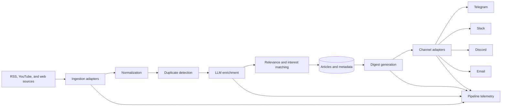

# Vector Daily: Engineering an AI News Intelligence Pipeline

[Live product](https://ai-news-aggregator-frontend-251j.onrender.com/) · [API documentation](https://ai-news-aggregator-sre8.onrender.com/docs) · [Portfolio case study](https://dhiranreddy.cyou/#work)

Vector Daily is a backend-heavy AI news product that ingests content from multiple source types, enriches it with LLM-assisted processing, and builds personalized digests for delivery across several channels.

> This repository is a public engineering case study. The production source code, deployment configuration, prompts, credentials, and provider integrations remain private.

## The problem

News aggregation is easy to demonstrate with a single feed and difficult to operate as a dependable pipeline. Sources fail, articles repeat, model output varies, delivery providers reject requests, and users care about different topics.

Vector Daily treats ingestion, enrichment, personalization, evaluation, and delivery as observable stages rather than one long background task.

## System overview

## Core capabilities

- Manage content sources and monitor source health
- Ingest articles from RSS, YouTube, and web sources
- Normalize article metadata across source types
- Summarize and categorize content with LLMs
- Detect near-duplicate coverage
- Match articles to user topics and interests
- Generate personalized digests
- Deliver through Telegram, Slack, Discord, and email adapters
- Track pipeline runs, stage outcomes, and notification attempts
- Expose quality, duplicate, topic, and coverage reports

## Engineering decisions

### Pipeline stages are independently observable

Each run has identifiable stages and outcomes. This makes it possible to distinguish a source failure from an enrichment failure or a notification-provider failure.

### Sources and delivery channels use adapters

External providers differ in authentication, payload structure, throttling, and failure behavior. Adapter boundaries prevent provider-specific logic from spreading across the pipeline.

### Personalization is explicit data

User interests and preferences are stored as first-class entities. Relevance is computed against those preferences rather than being hidden entirely inside an uninspectable prompt.

### Evaluation is part of the application surface

The API exposes reports for quality review, near-duplicate detection, topic coverage, and interest coverage. Evaluation is treated as an ongoing operational concern rather than a one-time notebook exercise.

## Public interface

The API documentation demonstrates implemented interfaces for:

- Authentication and account management
- Source CRUD and health monitoring
- Article listing and feedback
- Digest retrieval
- User interests and preferences
- Saved articles
- Pipeline triggering and run inspection
- Notifier configuration and delivery attempts
- Quality and coverage evaluation

## Security boundary

The public case study does **not** publish:

- Provider API keys, bot tokens, SMTP credentials, or signing secrets
- Production database configuration
- Complete prompt and ranking implementation
- Infrastructure topology or deployment credentials
- Private user preferences, messages, or delivery history
- Administrative access procedures

## Evaluation approach

The evaluation plan separates model quality from pipeline reliability:

### Content quality

- Summary faithfulness to the source article
- Category consistency
- Topic and interest coverage
- Near-duplicate detection precision
- Relevance-ranking review

### Operational quality

- Source success rate and freshness
- Per-stage failure rate
- End-to-end run duration
- Delivery success and retry outcomes
- Provider-specific error distribution

Metrics should be published with their measurement window and sample size. Unverified adoption or geographic claims are intentionally excluded.

## What I learned

- The difficult part of aggregation is controlling variability across sources and providers.
- A pipeline needs stage-level telemetry before it needs more automation.
- LLM evaluation is most useful when connected to concrete product decisions.
- Personalization should remain inspectable and user-controlled.
- Delivery needs idempotency and traceable retry behavior to avoid duplicate notifications.

## Status

Vector Daily is an independently built portfolio product. The live deployment may use resource-saving infrastructure and can take time to wake after inactivity.

